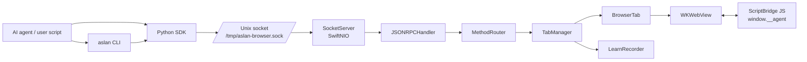
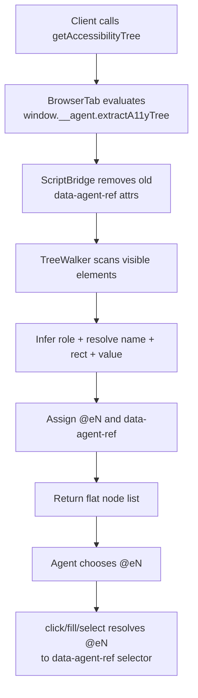
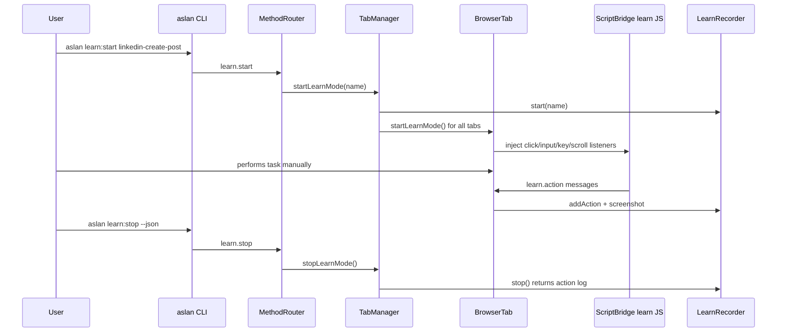

# Aslan Browser Developer Onboarding

> Fastest path to becoming productive in this codebase. Read this first, then keep `docs/workflows/conventions.md` and `docs/workflows/notes.md` open while working.

## 0. What this project is

Aslan Browser is a native macOS browser built for AI agents:

- **Rendering:** `WKWebView` hosted by AppKit `NSWindow`s.
- **Control plane:** newline-delimited JSON-RPC 2.0 over a Unix domain socket at `/tmp/aslan-browser.sock`.
- **Primary perception API:** a compact accessibility tree with ephemeral refs like `@e0`, not raw DOM.
- **Clients:** zero-runtime-dependency Python SDK plus `aslan` CLI.
- **Agent layer:** a Prompts-as-Code skill under `skills/aslan-browser/` with site knowledge and playbooks.

The core product bet is correct: for agents, the accessibility tree is usually a better interface than screenshots or DOM dumps. It is smaller, faster, structured, and directly actionable.

---

## 1. First-hour checklist

### Build and run

```bash
cd /Users/onorbumbum/_PROJECTS/aslan-browser/aslan-browser

xcodebuild build \
  -scheme aslan-browser \
  -configuration Debug \
  -derivedDataPath .build

.build/Build/Products/Debug/aslan-browser.app/Contents/MacOS/aslan-browser
# or hidden:
.build/Build/Products/Debug/aslan-browser.app/Contents/MacOS/aslan-browser --hidden
```

### Install/use the SDK and CLI

```bash
cd sdk/python
pip install -e ".[dev]"

aslan status
aslan nav https://example.com --wait load
aslan tree
```

### Run tests

The app must be running first.

```bash
# Python SDK + CLI integration tests
cd /Users/onorbumbum/_PROJECTS/aslan-browser/aslan-browser/sdk/python
python3 -m pytest tests/ -v

# Raw socket integration tests
cd /Users/onorbumbum/_PROJECTS/aslan-browser/aslan-browser
python3 tests/test_socket.py

# Benchmark
python3 benchmarks/benchmark.py
```

Blunt note: the meaningful automated coverage is mostly Python integration coverage. `aslan-browserTests/aslan_browserTests.swift` is still a template stub. If you change Swift behavior, add coverage through the socket/SDK test path at minimum. Do not rely on manual poking alone.

---

## 2. Repository map

```text
aslan-browser/
├── aslan-browser/                  # Swift app source
│   ├── AppDelegate.swift            # App lifecycle; creates tab0 and socket server
│   ├── SocketServer.swift           # SwiftNIO Unix socket listener + NDJSON framing
│   ├── JSONRPCHandler.swift         # JSON-RPC parse, dispatch, responses, session cleanup
│   ├── MethodRouter.swift           # Maps method names to BrowserTab/TabManager operations
│   ├── TabManager.swift             # Tabs, sessions, learn recorder ownership
│   ├── BrowserTab.swift             # WKWebView wrapper; navigation, interaction, screenshots, UI
│   ├── ScriptBridge.swift           # Injected JavaScript bridge and learn-mode listeners
│   ├── LearnRecorder.swift          # Learn-mode state machine and screenshot/action log
│   └── Models/                      # RPC, errors, tab info, a11y structs
├── sdk/python/
│   ├── aslan_browser/client.py       # Sync SDK
│   ├── aslan_browser/async_client.py # Async SDK + event callbacks
│   ├── aslan_browser/cli.py          # `aslan` command-line interface
│   ├── SDK_REFERENCE.md
│   ├── CLI_REFERENCE.md
│   └── tests/                        # SDK/CLI integration tests
├── skills/aslan-browser/             # AI-agent skill, knowledge, playbooks
├── docs/
│   ├── prd.md                        # Original product/design intent; some old details differ
│   ├── agents.md                     # Agent/release/version guidance
│   ├── prompts-are-code.md
│   └── workflows/                    # Phase implementation docs + conventions + notes
├── tests/                            # Raw socket/manual tests
├── benchmarks/                       # Performance benchmark harness
├── assets/                           # Logo/assets
└── aslan-browser.xcodeproj
```

Generated/build artifacts to avoid committing: `.build/`, `.build-x86/`, `.pytest_cache/`, `__pycache__/`, `*.profraw`, `*.sync-conflict-*`, `.DS_Store`, packaged `.app` contents unless intentionally releasing.

---

## 3. System architecture



The request path is intentionally simple:

1. Client sends one JSON line.
2. `SocketServer` splits by newline.
3. `JSONRPCHandler` parses JSON-RPC and jumps to `@MainActor`.
4. `MethodRouter` validates params and routes.
5. `TabManager` resolves/creates tabs or sessions.
6. `BrowserTab` performs WebKit work.
7. Response is serialized as one JSON line.

All WebKit work must stay on the main actor. This is not optional; WebKit is main-thread-bound.

---

## 4. Runtime lifecycle

### Launch

`AppDelegate.applicationDidFinishLaunching`:

1. Builds the app menu.
2. Creates `TabManager`.
3. Creates default `tab0`.
4. Creates `MethodRouter`.
5. Starts `SocketServer` on `/tmp/aslan-browser.sock`.
6. Wires `TabManager.broadcastEvent` to `SocketServer.broadcast`.

Key file refs:

- `aslan-browser/AppDelegate.swift:30` — socket path.
- `aslan-browser/AppDelegate.swift:32` — launch setup.
- `aslan-browser/TabManager.swift:58` — tab creation.
- `aslan-browser/SocketServer.swift:90` — server start.

### Socket protocol

One request/response per newline-delimited JSON object:

```json
{"jsonrpc":"2.0","id":1,"method":"navigate","params":{"tabId":"tab0","url":"https://example.com"}}
```

Notifications have no `id` and can interleave with responses:

```json
{"jsonrpc":"2.0","method":"event.navigation","params":{"tabId":"tab0","url":"https://example.com"}}
```

Clients must read until the matching response `id`, skipping notifications. Both SDK clients do this. One-off socket scripts often get this wrong.

---

## 5. Core Swift components

### `SocketServer.swift`

Responsibilities:

- Removes stale socket file on startup/shutdown.
- Starts a SwiftNIO `ServerBootstrap` with one event-loop thread.
- Uses a custom `LineBasedFrameDecoder` to split NDJSON frames.
- Tracks connected client channels and broadcasts JSON-RPC notifications.

Important refs:

- `LineBasedFrameDecoder` — `aslan-browser/SocketServer.swift:13`.
- `broadcast` — `aslan-browser/SocketServer.swift:68`.
- `start` — `aslan-browser/SocketServer.swift:90`.

### `JSONRPCHandler.swift`

Responsibilities:

- Parse incoming JSON-RPC requests.
- Dispatch to `MethodRouter` on `@MainActor`.
- Serialize success/error responses.
- Track sessions created by this connection and auto-destroy them on disconnect.

Important refs:

- `channelInactive` cleanup — `aslan-browser/JSONRPCHandler.swift:31`.
- `channelRead` parse/dispatch — `aslan-browser/JSONRPCHandler.swift:71`.

### `MethodRouter.swift`

This is the API surface. To understand what the browser can do, read the `dispatch` switch first.

Supported families:

- Navigation: `navigate`, `goBack`, `goForward`, `reload`, `waitForSelector`.
- Page info/extraction: `getTitle`, `getURL`, `evaluate`, `getAccessibilityTree`, `screenshot`.
- Interaction: `click`, `fill`, `select`, `keypress`, `scroll`, `uploadFile`.
- Cookies: `getCookies`, `setCookie`.
- Tabs/sessions: `tab.create`, `tab.close`, `tab.list`, `session.create`, `session.destroy`.
- Batch: `batch`.
- Learn mode: `learn.start`, `learn.stop`, `learn.status`, `learn.note`.

Important refs:

- `dispatch` — `aslan-browser/MethodRouter.swift:18`.
- Batch handling — `aslan-browser/MethodRouter.swift:362`.

### `TabManager.swift`

Responsibilities:

- Owns all `BrowserTab` instances.
- Generates IDs: `tab0`, `tab1`, ... and sessions `s0`, `s1`, ...
- Owns the single `LearnRecorder` shared by all tabs.
- Handles close-window callbacks safely.

Important implementation detail: `closeTab` keeps closed tabs in `closingTabs` briefly to avoid AppKit window-animation use-after-free crashes.

Important refs:

- Sessions — `aslan-browser/TabManager.swift:37`.
- Create tab — `aslan-browser/TabManager.swift:58`.
- Close tab — `aslan-browser/TabManager.swift:91`.
- Learn mode propagation — `aslan-browser/TabManager.swift:128`.

### `BrowserTab.swift`

This is the large, central class. It owns one `WKWebView`, one `NSWindow`, optional popup panels, loading UI, readiness state, and all page operations.

Responsibilities:

- Creates the AppKit window/URL bar/status bar/recording UI.
- Configures `WKWebViewConfiguration` and injects `ScriptBridge`.
- Handles navigation readiness (`load`, `idle`, `none`).
- Runs JS using `callAsyncJavaScript`.
- Extracts accessibility tree.
- Performs click/fill/select/key/scroll/upload.
- Takes screenshots.
- Handles cookies.
- Handles `window.open`, OAuth popups, JS dialogs, and native file picker.
- Re-injects learn-mode listeners after navigation.

Important refs:

- Init and UI setup — `aslan-browser/BrowserTab.swift:62`.
- Script messages — `aslan-browser/BrowserTab.swift:234`.
- Navigate — `aslan-browser/BrowserTab.swift:427`.
- Wait for selector — `aslan-browser/BrowserTab.swift:496`.
- A11y tree — `aslan-browser/BrowserTab.swift:510`.
- Click/fill/upload — `aslan-browser/BrowserTab.swift:534`, `:567`, `:554`.
- Screenshot — `aslan-browser/BrowserTab.swift:740`.
- Popup support — `aslan-browser/BrowserTab.swift:836`.
- Native file picker — `aslan-browser/BrowserTab.swift:956`.
- Navigation finish and learn-mode re-injection — `aslan-browser/BrowserTab.swift:1009`.

### `ScriptBridge.swift`

Injected into pages as `window.__agent`.

Core capabilities:

- Posts messages back to Swift through `window.webkit.messageHandlers.agent`.
- Tracks network activity by monkey-patching `fetch` and `XMLHttpRequest`.
- Tracks DOM stability with `MutationObserver`.
- Extracts the accessibility tree.
- Captures console and JS errors as events.
- Implements `waitForSelector`.
- Adds learn-mode listeners for click/input/keydown/scroll.

Important refs:

- Main bridge — `aslan-browser/ScriptBridge.swift:10`.
- A11y extraction — `aslan-browser/ScriptBridge.swift:314`.
- Learn mode JS — `aslan-browser/ScriptBridge.swift:452`.

### `LearnRecorder.swift`

Small state machine:

- `idle` or `recording`.
- Creates `/tmp/aslan-learn/<name>/`.
- Stores action objects with sequence numbers and timestamps.
- Writes step screenshots from base64 JPEG.

Important refs:

- Start — `aslan-browser/LearnRecorder.swift:22`.
- Add action — `aslan-browser/LearnRecorder.swift:74`.

---

## 6. Accessibility tree mental model

The accessibility tree is the primary agent API.



A node looks like:

```json
{"ref":"@e0","role":"link","name":"Sign in","tag":"A","rect":{"x":10,"y":50,"w":80,"h":24}}
```

Rules that matter:

- Refs are **ephemeral**. Every tree extraction removes and reassigns refs.
- Hidden elements are excluded (`aria-hidden`, `display:none`, `visibility:hidden`, zero rect).
- Included elements are interactive/semantic: links, buttons, inputs, selects, textareas, headings, landmarks, explicit ARIA roles, lists/tables/images.
- Names resolve by `aria-label`, `aria-labelledby`, label, placeholder, title, then visible text.
- `value` only appears for form elements.

Screenshots are still useful, but mostly for visual verification. If you default to screenshots for control, you are throwing away the project’s main advantage.

---

## 7. Python SDK and CLI

### Sync SDK

`aslan_browser.client.AslanBrowser`:

- Uses stdlib `socket`, `json`, `base64`.
- Connects to `/tmp/aslan-browser.sock` with retry.
- Auto-creates a session by default (`sdk-auto`) and closes it on `close()`.
- Skips JSON-RPC notifications while waiting for matching response IDs.

Typical use:

```python
from aslan_browser import AslanBrowser

with AslanBrowser() as browser:
    browser.navigate("https://example.com", wait_until="idle")
    tree = browser.get_accessibility_tree()
    browser.click(tree[0]["ref"])
```

### Async SDK

`aslan_browser.async_client.AsyncAslanBrowser`:

- Uses `asyncio.open_unix_connection`.
- Maintains `_pending` futures by request ID.
- Background read loop routes responses and notifications.
- Supports `on_event(callback)`.

Use this for concurrent/multi-agent orchestration or event-driven flows.

### CLI

`aslan_browser.cli` exposes the `aslan` command. This is the preferred interface for AI-agent skills because it is low-token and step-oriented.

Common commands:

```bash
aslan status
aslan nav https://example.com --wait idle
aslan tree
aslan click @e2
aslan type @e3 "hello"       # works better for contenteditable than fill
aslan shot /tmp/page.jpg
aslan tab:new https://site.com
aslan tabs
aslan learn:start site-task
aslan learn:stop --json
```

CLI state lives in `/tmp/aslan-cli.json` and mainly tracks current tab.

---

## 8. Learn mode

Learn mode records a human demonstration and turns it into reusable agent knowledge.



Important details:

- Screenshots are written to `/tmp/aslan-learn/<name>/step-NNN.jpg`.
- Input events are debounced.
- Learn JS must be re-injected after navigation; `BrowserTab.didFinish` does this.
- The record button/note UI is native AppKit UI in the browser window.
- `learn.note`/the 📝 button adds annotations into the log.

---

## 9. Adding a new JSON-RPC feature

Do this test-first. TDD is not ceremony here; without tests, every protocol change becomes a manual regression hunt.

1. **Write or extend an integration test first**
   - SDK behavior: `sdk/python/tests/test_integration.py` or `test_cli.py`.
   - Raw protocol behavior: `tests/test_socket.py`.

2. **Add the Swift domain behavior**
   - If it touches a page: implement on `BrowserTab`.
   - If it manages tabs/sessions/global state: implement on `TabManager`.
   - If it records/learns: implement in `LearnRecorder`/`ScriptBridge` as needed.

3. **Route it**
   - Add a case in `MethodRouter.dispatch`.
   - Validate params with explicit `invalidParams` errors.
   - Return JSON-serializable dictionaries/arrays only.

4. **Add SDK wrapper**
   - Sync: `sdk/python/aslan_browser/client.py`.
   - Async: `sdk/python/aslan_browser/async_client.py` if relevant.

5. **Add CLI command if agents will use it often**
   - Parser entry in `_build_parser`.
   - `cmd_*` implementation.
   - Update `CLI_REFERENCE.md` / `SDK_REFERENCE.md` and skill docs.

6. **Update docs and knowledge**
   - `README.md` API reference if public.
   - `skills/aslan-browser/knowledge/core.md` if it changes operating behavior.
   - `docs/workflows/notes.md` for gotchas discovered during implementation.

7. **Run tests with the new app binary running**

8. **Versioning**
   - Swift/app behavior change: bump `MARKETING_VERSION` / `CURRENT_PROJECT_VERSION` in `aslan-browser.xcodeproj/project.pbxproj` per `docs/agents.md`.
   - Python SDK behavior change: bump `sdk/python/pyproject.toml` if distributing.

---

## 10. Build, version, and release basics

Current source-derived settings observed in the project file:

- App version: `MARKETING_VERSION = 1.5.0`
- Build number: `CURRENT_PROJECT_VERSION = 7`
- Deployment target: macOS `14.0`
- `SWIFT_VERSION = 5.0` build setting
- `ENABLE_APP_SANDBOX = NO`
- `ENABLE_USER_SCRIPT_SANDBOXING = NO`
- SDK package version: `sdk/python/pyproject.toml` has `0.5.0`

Release guidance lives in `docs/agents.md`.

Universal release build:

```bash
xcodebuild -project aslan-browser.xcodeproj -scheme aslan-browser \
  -configuration Release ARCHS="arm64 x86_64" ONLY_ACTIVE_ARCH=NO build \
  2>&1 | grep -E "error:|BUILD SUCCEEDED|BUILD FAILED"
```

Verify universal binary:

```bash
DERIVED="$HOME/Library/Developer/Xcode/DerivedData/aslan-browser-*/Build/Products/Release"
lipo -info $DERIVED/aslan-browser.app/Contents/MacOS/aslan-browser
```

---

## 11. Known gotchas and sharp edges

Read `docs/workflows/notes.md` for the full history. These are the ones that most often waste time:

1. **Event notifications interleave with responses**
   - Never read just the first socket line after a request. Match by `id`.

2. **Refs are short-lived**
   - `@eN` refs are valid only after the most recent `tree` extraction.

3. **`http://` often fails under ATS**
   - Prefer `https://` or retry HTTPS on navigation errors.

4. **WKWebView is main-thread-bound**
   - Keep WebKit calls in `BrowserTab` / `@MainActor` paths.

5. **Hidden is not headless**
   - `--hidden` hides windows but still keeps WKWebView in an AppKit window hierarchy. That is necessary for reliable rendering and JS/WebSockets.

6. **Contenteditable fields need `type`, not `fill`**
   - CLI `aslan type` handles contenteditable and React-ish inputs better.

7. **Native file upload has two paths**
   - Swift `uploadFile` queues URLs for the native picker path.
   - CLI `aslan upload` uses DataTransfer injection.

8. **Popup/OAuth support is delicate**
   - Do not manually call `.load()` in `createWebViewWith`; WebKit auto-loads returned popup webviews.
   - Keep popup navigation delegates retained.
   - Debug popup chains via `/tmp/aslan-popup.log`.

9. **Stale binaries are common**
   - `/Applications/aslan-browser.app` may be stale. During development launch the DerivedData or `.build` binary you just built.

10. **Docs can lag source**
   - The original PRD mentions old protocol ideas like HTTP endpoints/SSE/raw screenshot bytes. Current source and `docs/workflows/conventions.md` are authoritative: NDJSON JSON-RPC, base64 screenshots in JSON, JSON-RPC notifications.
   - Some docs mention a Chrome custom UA by default, but current Swift source should be checked before relying on that claim.

11. **Syncthing conflict files can break builds**
   - `*.sync-conflict-*` files are ignored, but if they appear under synchronized source groups, remove them before building.

---

## 12. Testing strategy

Current coverage layers:

| Layer | Files | What it proves |
|---|---|---|
| Raw socket integration | `tests/test_socket.py` | JSON-RPC framing, error codes, tabs, navigation, events, cookies, screenshots |
| SDK integration | `sdk/python/tests/test_integration.py` | Sync + async client behavior over real app |
| CLI integration | `sdk/python/tests/test_cli.py` | `aslan` commands and compact outputs |
| Learn mode | `sdk/python/tests/test_learn.py` | Recording lifecycle, screenshots, navigation capture |
| Benchmarks | `benchmarks/benchmark.py` | JS eval, screenshot, a11y tree performance |
| Swift unit/UI tests | `aslan-browserTests/`, `aslan-browserUITests/` | Mostly template coverage today |

Preferred regression pattern:

1. Write a failing Python integration test that exercises the public behavior.
2. Make the smallest Swift/SDK change to pass it.
3. Refactor after green.
4. Run the relevant full test file.

For legacy or fragile areas, add characterization tests first. Michael Feathers was right: code without tests is legacy code, even if you wrote it yesterday.

---

## 13. Agent skill and knowledge layer

`skills/aslan-browser/` is not application runtime code; it teaches AI agents how to use the browser.

Key files:

- `SKILL.md` — when and how agents should drive Aslan.
- `SDK_REFERENCE.md` — command/API cheat sheet.
- `knowledge/core.md` — global operating rules and gotchas.
- `knowledge/sites/*.md` — site-specific quirks/selectors.
- `knowledge/playbooks/*.md` — repeatable task recipes.
- `learnings/` — compiled learnings; `user.md` is user-specific and gitignored.

The skill’s operating loop is intentionally stepwise:

```text
navigate → read tree/text → decide → one action → read again
```

Do not replace this with pre-planned multi-step automation unless the task is deterministic and already captured in a playbook. Web pages are hostile, dynamic systems; fast feedback beats clever scripts.

---

## 14. Product/design intent

Why this architecture exists:

- Puppeteer/Playwright are excellent general browser automation tools, but they are not optimized for LLM token budgets.
- An accessibility tree gives an LLM the actionable page state directly.
- A Unix socket avoids local port conflicts and keeps IPC cheap.
- WKWebView avoids shipping Chromium.
- AppKit gives direct control over hidden/visible windows and native dialogs.
- JSON-RPC keeps the protocol language-agnostic.

Non-goals from the docs still matter:

- Not cross-platform.
- Not a general-purpose browser.
- Not a full CDP clone.
- Not trying to intercept every network request/response body.

When adding features, preserve that focus. Kelsey Hightower’s “no code is the best code” applies: if a feature can live in the SDK/skill/playbook instead of the Swift app, think hard before making the app bigger.

---

## 15. Glossary

- **A11y tree** — Flat list of actionable/semantic page elements extracted by injected JS.
- **`@eN` ref** — Ephemeral element reference assigned during tree extraction.
- **NDJSON** — newline-delimited JSON; one JSON-RPC message per line.
- **Notification** — JSON-RPC message without `id`, used for events.
- **Session** — Logical grouping of tabs, useful for multi-agent cleanup/isolation.
- **Learn mode** — Browser-recorded human demonstration that becomes a playbook.
- **Playbook** — Agent-readable repeatable recipe for a site/task.
- **`tab0`** — Default shared tab created at app launch.

---

## 16. Best next reads

1. `README.md` — product overview and public API.
2. `docs/workflows/conventions.md` — current architecture and code rules.
3. `docs/workflows/notes.md` — implementation gotchas; very high value.
4. `aslan-browser/MethodRouter.swift` — complete RPC surface.
5. `aslan-browser/BrowserTab.swift` — main browser mechanics.
6. `aslan-browser/ScriptBridge.swift` — page-side behavior.
7. `sdk/python/aslan_browser/client.py` — simplest complete client implementation.
8. `skills/aslan-browser/SKILL.md` — how agents are expected to use the browser.
